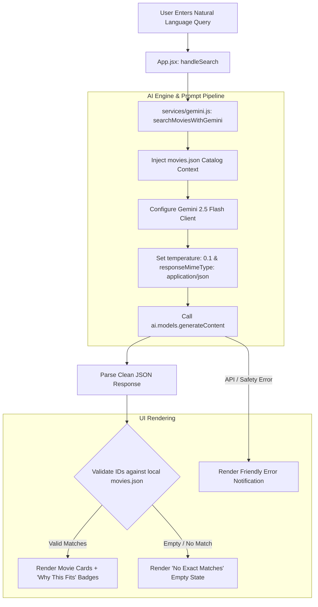

# 🎬 StreamFlix — AI Vibe Search Engine

<p align="center">
  
</p>

<p align="center">
  <strong>Next-Generation Natural Language Movie Discovery Powered by Google Gemini 2.5 Flash & React 19</strong>
</p>

<p align="center">
  
  
  
  
</p>

---

## 📖 Table of Contents

- [Overview](#-overview)
- [Key Features](#-key-features)
- [System Architecture](#-system-architecture)
- [Technical Deep Dive](#-technical-deep-dive)
  - [Prompt Engineering & Schema Enforcement](#prompt-engineering--schema-enforcement)
  - [Hallucination Prevention & Defensive Reconciliation](#hallucination-prevention--defensive-reconciliation)
  - [Safety & Error Handling](#safety--error-handling)
- [Tech Stack](#-tech-stack)
- [Project Directory Structure](#-project-directory-structure)
- [Getting Started](#-getting-started)
  - [Prerequisites](#prerequisites)
  - [Installation & Setup](#installation--setup)
- [Sample Queries to Try](#-sample-queries-to-try)
- [UI & Design System](#-ui--design-system)
- [Future Roadmap](#-future-roadmap)

---

## 🌟 Overview

Traditional movie discovery platforms rely on rigid, one-dimensional filters like genre dropdowns, release years, or exact actor matches. **StreamFlix Vibe Search** reimagines the search experience by enabling users to describe their exact mood, emotional vibe, pacing preferences, and content constraints in natural language.

Whether you're looking for *"a nostalgic 80s treasure hunt full of puzzles and lighthearted adventure"* or *"a mind-bending dystopian sci-fi that is safe for older kids with low violence"*, StreamFlix analyzes the underlying subtext, identifies the best matches from the movie database, and returns personalized explanations for why each title was selected.

---

## ✨ Key Features

- 🧠 **Semantic Natural Language Search**: Understands complex tones, subjective feelings, negative constraints (e.g., *"not scary"*, *"no gore"*), and hybrid themes.
- 🎯 **Guaranteed JSON Output**: Utilizes Gemini's native `responseMimeType: "application/json"` combined with explicit schema definitions to eliminate markdown wrappers and parsing failures.
- 🛡️ **Zero-Hallucination Pipeline**: Restricts model reasoning exclusively to an injected movie catalog with defensive client-side ID reconciliation.
- ✨ **Contextual "Why This Fits" Badges**: Generates real-time, 1-sentence explanations detailing why each recommendation matches the user's specific prompt.
- 🎨 **Sleek Streaming Platform UI**: Dark-mode aesthetic (`#0d0d0f`) with glassmorphism, responsive CSS grid, vibrant linear gradients, and smooth hover micro-interactions.
- ⚡ **Skeleton Loading States**: Seamless animated placeholder loading bars while semantic inference takes place.
- 🚨 **Graceful Edge-Case Handling**: Dedicated states for empty queries, unmatched vibes, missing API keys, safety blocks, and network disruptions.
- 🪶 **Zero UI Framework Bloat**: Crafted entirely with Vanilla CSS for full styling control, ultra-fast render times, and zero external runtime overhead.

---

## 🏗️ System Architecture



---

## 🔬 Technical Deep Dive

### Prompt Engineering & Schema Enforcement

To achieve high reliability and prevent unpredictable LLM behavior, the prompt engineering pipeline applies strict constraints:

1. **Structured Schema Definition**: The prompt dictates an explicit output contract:
   ```json
   {
     "matches": [
       {
         "id": "Number",
         "explanation": "String"
       }
     ]
   }
   ```
2. **Context Injection**: The complete local catalog (`src/data/movies.json`) is serialized into the prompt, grounding the AI's knowledge base.
3. **Native JSON MIME Configuration**: Configured with `responseMimeType: "application/json"` in `@google/genai`. This forces Gemini to output valid JSON internally without needing regex cleanup for markdown fences (````json ... ````).
4. **Deterministic Temperature**: Calibrated to `0.1` to prioritize strict semantic precision over creative hallucination.

#### Prompt Template

```javascript
const prompt = `
You are an expert movie recommendation engine for a premium streaming app.
Your task is to match the user's natural language mood/vibe query perfectly against our database of movies.

USER QUERY: "${userQuery}"

AVAILABLE MOVIES DATABASE:
${JSON.stringify(moviesData, null, 2)}

INSTRUCTIONS:
1. Examine the user's query carefully to understand the tone, genre, vibe, and constraints (e.g. "safe for kids", "not scary").
2. Find the top 1 to 3 best matching movies from the PROVIDED DATABASE ONLY. Do not invent or hallucinate movies that are not in the database.
3. For each match, write a 1-sentence explanation of why it fits the query exactly.
4. If no movies match the query safely or the query is inappropriate, return an empty array.
5. YOU MUST RESPOND IN PURE JSON FORMAT ONLY. Do not wrap it in markdown block quotes. Just output the raw JSON.

EXPECTED JSON SCHEMA:
{
  "matches": [
    {
      "id": Number,
      "explanation": "String"
    }
  ]
}
`;
```

---

### Hallucination Prevention & Defensive Reconciliation

Even with strict prompts, client-side resilience is essential. The frontend employs a two-tier reconciliation strategy:

```javascript
const matchingMovies = geminiMatches.map(match => {
  const movieDetails = moviesData.find(m => m.id === match.id);
  return {
    ...movieDetails,
    explanation: match.explanation
  };
}).filter(m => m.id !== undefined); // Prevents rendering of undefined IDs
```

- **ID-Only Return**: Gemini only returns IDs and short explanations, never duplicated movie metadata.
- **Local Source of Truth**: All titles, genres, ratings, release years, and poster URLs are retrieved directly from the verified local dataset.
- **Defensive Filtering**: Any unmapped or hallucinated ID is filtered out before state updates, preventing application crashes.

---

### Safety & Error Handling

- **Missing API Key**: Instantly catches missing configuration in `services/gemini.js` with clear guidance to add keys to `.env`.
- **Content Safety & Moderation**: Gemini safety flags or blocked prompts are trapped in standard `try/catch` blocks and translated into user-friendly UI messages (`Oops! Something went wrong processing your request.`).
- **Zero Results**: Unmatched queries render a friendly empty state encouraging the user to broaden their search parameters.

---

## 🛠️ Tech Stack

| Category | Technology | Description |
| :--- | :--- | :--- |
| **Frontend Library** | [React 19](https://react.dev/) | Modern UI components with hooks (`useState`) |
| **Build Tooling** | [Vite 7](https://vitejs.dev/) | Ultra-fast HMR and optimized production bundling |
| **AI SDK & Model** | [@google/genai](https://www.npmjs.com/package/@google/genai) | Official SDK running Google Gemini 2.5 Flash |
| **Styling** | Vanilla CSS3 | Custom design system with CSS variables & glassmorphism |
| **Linting** | ESLint 9 | Code quality and React Hooks safety checks |

---

## 📂 Project Directory Structure

```text
vibe-search/
├── .env.example                # Template for environment variables
├── .gitignore                  # Git ignore rules (node_modules, .env)
├── eslint.config.js            # ESLint rules & parser config
├── index.html                  # HTML5 entrypoint
├── package.json                # Dependencies and npm scripts
├── vite.config.js              # Vite React configuration
├── README.md                   # Application documentation
├── public/                     # Static public assets
└── src/
    ├── assets/                 # Icons and branding assets
    ├── data/
    │   └── movies.json         # Curated movie catalog with rich plot summaries
    ├── services/
    │   └── gemini.js           # Gemini 2.5 Flash integration & prompt pipeline
    ├── App.css                 # Search bar, movie grid, card styles & animations
    ├── App.jsx                 # Core application state & UI layout
    ├── index.css               # Global tokens, typography, dark theme variables
    └── main.jsx                # Application root DOM mount
```

---

## 🚀 Getting Started

### Prerequisites

- **Node.js** (v18.0.0 or higher recommended)
- **npm** (or yarn / pnpm)
- **Google Gemini API Key**: Obtain a free API key from [Google AI Studio](https://aistudio.google.com/).

### Installation & Setup

1. **Navigate to the application directory**:
   ```bash
   cd vibe-search
   ```

2. **Install dependencies**:
   ```bash
   npm install
   ```

3. **Configure Environment Variables**:
   Create a `.env` file (or copy from `.env.example`):
   ```bash
   cp .env.example .env
   ```

   Open `.env` and paste your Gemini API key:
   ```env
   VITE_GEMINI_API_KEY=your_actual_gemini_api_key_here
   ```

4. **Launch the Development Server**:
   ```bash
   npm run dev
   ```
   Open `http://localhost:5173` in your browser.

5. **Production Build & Preview**:
   ```bash
   npm run build
   npm run preview
   ```

---

## 💡 Sample Queries to Try

Test the semantic matching with these diverse vibe queries:

| Query | Expected Vibe & Matching Logic |
| :--- | :--- |
| `A dystopian sci-fi with mind-bending concepts but no gore` | Identifies mind-bending sci-fi themes while honoring low-violence constraints. |
| `Heartwarming cozy romance that won't make me cry` | Selects uplifting romantic stories with comforting, gentle tones. |
| `Fast-paced cynical comedy with dark sarcasm and road trips` | Discovers biting, edgy comedic adventures with high pacing. |
| `Classic 80s treasure hunting adventure full of traps and puzzles` | Matches nostalgic, family-friendly retro adventure quests. |
| `A cerebral, complex heist movie about dreams and secrets` | Accurately maps to complex psychological suspense thrillers. |

---

## 🎨 UI & Design System

The application features a streaming-inspired dark theme built entirely with CSS custom properties:

```css
:root {
  --bg-color: #0d0d0f;
  --surface-color: #1a1b1e;
  --surface-hover: #2a2b2e;
  --primary-color: #e50914;
  --text-primary: #ffffff;
  --text-secondary: #a1a1aa;
  --border-radius-sm: 8px;
  --border-radius-md: 12px;
  --border-radius-lg: 16px;
  --transition-speed: 0.2s;
}
```

- **Pill-Shaped Magic Search Bar**: Blurred backdrop with interactive focus rings.
- **Card Hover Elevation**: `-8px` Y-axis lift and depth drop-shadows on hover.
- **Poster Zoom Transition**: Subtle smooth image scaling (`scale(1.05)`) on card interaction.
- **Responsive Layout**: CSS Grid utilizing `repeat(auto-fill, minmax(280px, 1fr))` for mobile, tablet, and desktop viewports.

---

## 🗺️ Future Roadmap

- [ ] **Vector Database Integration**: Scale catalog to 100,000+ movies using vector embeddings (e.g., ChromaDB / Pinecone).
- [ ] **Multi-Modal Search**: Enable image-based vibe searches (e.g., upload an aesthetic screenshot).
- [ ] **Streaming Token Responses**: Implement streaming AI tokens for instant response previews.
- [ ] **Personalized Watchlist**: LocalStorage-persisted bookmarks and playlist curation.
- [ ] **Direct Streaming Provider Links**: Deep integration with JustWatch / TMDB APIs for live streaming availability.

---

<p align="center">
  Built with ❤️ using React 19 and Google Gemini API.
</p>
